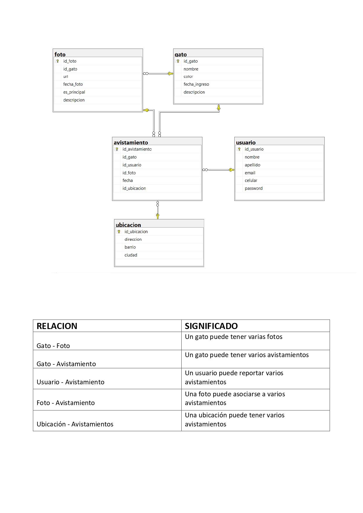

# GatoGo

   

## Cabecera

- Nombre del proyecto: GatoGo
- Estado: En desarrollo / listo para pruebas locales

## Resumen Ejecutivo

GatoGo es una aplicación web desarrollada con Java y Vaadin, orientada a la gestión de información relacionada con gatos, ubicaciones, usuarios, fotografías y avistamientos. La solución permite registrar y consultar datos clave de cada entidad mediante una interfaz de administración intuitiva y modular, con formularios, botones de CRUD y tablas de visualización.

El sistema está pensado como una base funcional para proyectos de seguimiento de gatos, reportes de avistamientos y gestión documental de evidencia visual. En su estado actual, la aplicación incluye una interfaz de usuario que centraliza la administración de:

- Gatos
- Ubicaciones
- Usuarios
- Avistamientos
- Fotografías

## Arquitectura

La arquitectura del proyecto se compone de cinco componentes principales:

1. Frontend: interfaz construida con Vaadin y componentes de UI para crear formularios, grillas y notificaciones.
2. Aplicación principal: Spring Boot actúa como contenedor y punto de arranque de la app.
3. Modelo de dominio: clases Java que representan las entidades del negocio (`Gato`, `User`, `Ubicacion`, `Foto`, `Avistamiento`).
4. Lógica de acceso a datos: `CrudService` usa JPA (`EntityManager`) para crear, consultar, actualizar y eliminar registros en PostgreSQL.
5. Capa de presentación: `MainView` centraliza las secciones y acciones CRUD para cada entidad.

Diagrama de alto nivel:

- Cliente web -> Vaadin UI -> `MainView`
- `MainView` -> `CrudService` -> JPA/Hibernate -> PostgreSQL
- `MainView` -> entidades del dominio
- `Application` -> Spring Boot runtime
- Las acciones CRUD consultan y persisten datos en PostgreSQL; la vista muestra notificaciones del resultado.

## Modelo de Datos

El modelo de datos del proyecto se organiza alrededor de cinco entidades principales.



### Asociaciones representadas

El diagrama presenta las asociaciones conceptuales del dominio. En el código actual, `Foto` y `Avistamiento` guardan algunos identificadores relacionados (`idGato`, `idUser` e `idFoto`) como campos numéricos; las entidades no definen asociaciones JPA (`@ManyToOne`, `@OneToMany`, etc.). Además, `Ubicacion` aún no está vinculada a `Avistamiento` en las clases Java.

## Stack Tecnológico

| Componente | Tecnología | Versión |
| --- | --- | --- |
| Lenguaje | Java | 25 |
| Framework backend | Spring Boot | 4.1.1 |
| Framework frontend | Vaadin | 25.3.0 |
| Build tool | Maven | 3.x |
| Contenedor | Docker | Compatible |
| Estilo visual | Vaadin Aura + CSS personalizado | - |

## Guía de Configuración

### Requisitos previos

- JDK 25
- Git
- Una base de datos PostgreSQL accesible
- Opcional: Docker

El repositorio incluye Maven Wrapper (`mvnw` y `mvnw.cmd`), así que no es necesario instalar Maven por separado.

### Clonar el repositorio

```bash
git clone https://github.com/laverdecata8a-netizen/proyecto-integrador-grupo1.git
cd proyecto-integrador-grupo1
```

### Configurar la conexión a PostgreSQL

La aplicación obtiene la URL, el usuario y la contraseña de conexión mediante las variables de entorno `DB_URL`, `DB_USERNAME` y `DB_PASSWORD`. Configúralas con los datos de tu base de datos antes de iniciar la aplicación. Por ejemplo, en PowerShell:

```powershell
$env:DB_URL="jdbc:postgresql://localhost:5432/gatogo"
$env:DB_USERNAME="<usuario>"
$env:DB_PASSWORD="<contraseña>"
```

Reemplaza los valores de ejemplo por los de tu entorno. No guardes contraseñas reales en el repositorio.

### Ejecutar en modo desarrollo

En macOS o Linux:

```bash
./mvnw spring-boot:run
```

En Windows PowerShell:

```powershell
.\mvnw.cmd spring-boot:run
```

La aplicación queda disponible en:

```text
http://localhost:8080
```

### Compilar para producción

En macOS o Linux:

```bash
./mvnw clean package
```

En Windows PowerShell:

```powershell
.\mvnw.cmd clean package
```

### Crear imagen Docker

```bash
docker build -t gatogo:latest .
```

Para ejecutar la imagen:

```bash
docker run -p 8080:8080 -e DB_URL="jdbc:postgresql://<host>:5432/<base_de_datos>" -e DB_USERNAME="<usuario>" -e DB_PASSWORD="<contraseña>" gatogo:latest
```

Sustituye los valores entre `< >` por los datos de tu base de datos PostgreSQL.

## Flujo de Trabajo

El proyecto sigue una metodología simple de control de versiones basada en ramas y commits atómicos:

- `main`: rama principal estable
- `feature/*`: desarrollo de nuevas funcionalidades
- `fix/*`: correcciones de errores
- `docs/*`: cambios de documentación o estructura de README

Se recomienda mantener mensajes de commit claros y funcionales, por ejemplo:

```bash
git add .
git commit -m "Agregar módulo de gestión de gatos"
```

## Licencia y Créditos

Este proyecto se distribuye bajo la licencia Unlicense, según se indica en el archivo `LICENSE.md`.

### Equipo de trabajo

- Coordinación general: equipo de proyecto Grupo 1
- Desarrollo frontend y UX: integración de Vista Vaadin y componentes UI
- Desarrollo backend y estructura del dominio: lógica de entidades y flujo de la aplicación
- Documentación y validación: revisión de requisitos, README y pruebas locales

## Notas adicionales

La aplicación ya cuenta con persistencia en PostgreSQL mediante JPA/Hibernate y una interfaz Vaadin para administrar las entidades. Entre las mejoras futuras posibles están completar las asociaciones JPA del modelo, incorporar validaciones avanzadas y añadir autenticación de usuarios.
